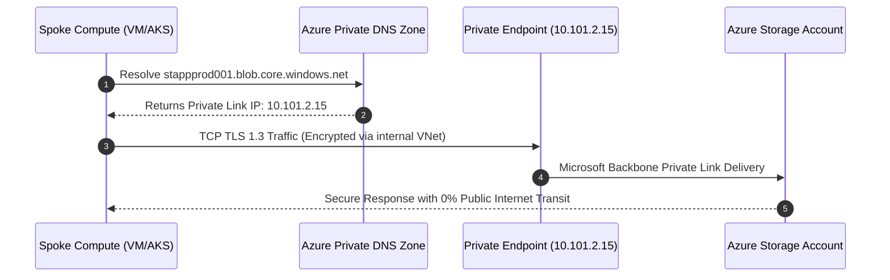

# 🏛️ Enterprise Cloud Landing Zone & Architecture Guide

> **Framework**: Microsoft Cloud Adoption Framework (CAF) for Azure  
> **Topology**: Hub-and-Spoke Transit Mesh with Centralized Firewall & Zero-Trust Perimeter  
> **Governance**: Policy-as-Code (PaC), Multi-Tier Management Groups, Privileged Identity Management (PIM)  

---

## 📑 Table of Contents
1. [Cloud Adoption Framework (CAF) Execution Matrix](#1-cloud-adoption-framework-caf-execution-matrix)
2. [Tenant & Management Group Hierarchy Specification](#2-tenant--management-group-hierarchy-specification)
3. [Enterprise IPAM & CIDR Planning](#3-enterprise-ipam--cidr-planning)
4. [Centralized Hub & Spoke Routing Engineering](#4-centralized-hub--spoke-routing-engineering)
5. [Private Endpoint & Private DNS Zone Resolution](#5-private-endpoint--private-dns-zone-resolution)
6. [Policy as Code & Formal Exemption Governance](#6-policy-as-code--formal-exemption-governance)
7. [Terraform State Security & Automated Drift Detection](#7-terraform-state-security--automated-drift-detection)

---

## 1. Cloud Adoption Framework (CAF) Execution Matrix

| CAF Phase | Strategic Deliverable | Technical Artifacts & Controls |
| :--- | :--- | :--- |
| **Strategy** | Business motivation, financial TCO models, and target cloud operating model. | Cloud Business Case, Cloud Adoption Plan, Architecture Review Board (ARB) charter. |
| **Plan** | Workload prioritization, organizational alignment, and skills readiness. | 6 R's rationalization matrix, RACI governance matrix, Wave migration schedule. |
| **Ready** | Automated Azure Landing Zone foundational provisioning. | Terraform Landing Zone repo, Hub VNet, Azure Firewall, Log Analytics, Entra ID PIM. |
| **Adopt** | Workload migration and cloud-native application modernization. | Multi-stage Azure DevOps CI/CD pipelines, containerization on AKS, database migration. |
| **Govern** | Policy-as-Code baselines, regulatory compliance, and FinOps accountability. | Azure Policy Initiatives (CIS, ISO 27001), Cost Management budgets, Resource tagging rules. |
| **Secure** | Zero-trust perimeter, identity protection, and continuous threat monitoring. | Microsoft Defender for Cloud, Sentinel SIEM, Key Vault CMEK encryption, NSG/ASG microsegmentation. |
| **Manage** | Ongoing SRE operations, business continuity, and performance baselining. | Azure Monitor alert action groups, BCDR failover runbooks, 99.99% SLA architecture. |

---

## 2. Tenant & Management Group Hierarchy Specification

The hierarchy strictly enforces security isolation between Platform subscriptions and Application workloads:

```
[Tenant Root Group]
 ├── [Platform Management Group]
 │    ├── [Connectivity Subscription]: Hub VNet, Azure Firewall Premium, ExpressRoute, VPN, Bastion.
 │    ├── [Identity Subscription]: Active Directory Domain Services, Central Key Vaults, Identity Federation.
 │    └── [Management Subscription]: Centralized Log Analytics Workspace, Azure Automation, Sentinel.
 │
 ├── [Landing Zones Management Group]
 │    ├── [Corp Workloads MG]: Internal private apps (No public IPs allowed by Azure Policy).
 │    │    ├── [Production Subscriptions]
 │    │    ├── [UAT Subscriptions]
 │    │    └── [Development Subscriptions]
 │    └── [Online Workloads MG]: Internet-facing apps (Protected by Front Door / WAF).
 │
 ├── [Sandbox Management Group]: Isolated playground for R&D; strict budget limits; no hybrid routing.
 └── [Decommissioned Management Group]: Archived subscriptions awaiting deletion; all ingress/egress revoked.
```

---

## 3. Enterprise IPAM & CIDR Planning

Carefully planned CIDR allocations prevent RFC 1918 overlap between legacy on-premises data centers and expanding multi-region cloud workloads:

```
Address Allocation Architecture:
├── On-Premises Enterprise Network:  10.0.0.0/12  (Covers legacy DCs, branches, campus)
├── Azure Primary Region (East US 2): 10.100.0.0/14
│   ├── Hub Virtual Network:         10.100.0.0/20
│   │   ├── GatewaySubnet:           10.100.0.0/24   (ExpressRoute & VPN gateways)
│   │   ├── AzureFirewallSubnet:     10.100.1.0/24   (Azure Firewall Premium cluster)
│   │   ├── AzureBastionSubnet:      10.100.2.0/26   (Secure management access)
│   │   └── SharedServicesSubnet:    10.100.3.0/24   (Private DNS Resolvers, forwarders)
│   ├── Spoke Prod Tier:             10.101.0.0/20
│   ├── Spoke UAT Tier:              10.102.0.0/20
│   └── Spoke Dev Tier:              10.103.0.0/20
└── Azure Paired Region (Central US): 10.104.0.0/14 (Disaster recovery secondary footprint)
```

---

## 4. Centralized Hub & Spoke Routing Engineering

All spoke virtual networks enforce centralized inspection via User-Defined Route (UDR) tables:

```
Spoke Subnet Route Table (rt-spoke-workload-prod):
┌─────────────────────────┬──────────────────┬──────────────────────┬───────────────────────────────┐
│ Route Name              │ Address Prefix   │ Next Hop Type        │ Next Hop IP Address           │
├─────────────────────────┼──────────────────┼──────────────────────┼───────────────────────────────┤
│ udr-default-egress      │ 0.0.0.0/0        │ VirtualAppliance     │ 10.100.1.4 (Azure Firewall)   │
│ udr-to-onprem-datacenter│ 10.0.0.0/12      │ VirtualAppliance     │ 10.100.1.4 (Azure Firewall)   │
│ udr-to-other-spokes     │ 10.100.0.0/14    │ VirtualAppliance     │ 10.100.1.4 (Azure Firewall)   │
│ udr-kms-activation      │ 20.118.99.224/32 │ Internet             │ Direct (Azure KMS activation) │
└─────────────────────────┴──────────────────┴──────────────────────┴───────────────────────────────┘
```

---

## 5. Private Endpoint & Private DNS Zone Resolution

To ensure zero data exfiltration to the public internet, all PaaS services (Azure SQL, Storage, Key Vault) communicate via Azure Private Link.



---

## 6. Policy as Code & Formal Exemption Governance

### Custom Policy Initiative: Enterprise Security Baseline
- **Deny Unencrypted Storage Accounts**: Enforces `supportsHttpsTrafficOnly = true` and `minimumTlsVersion = TLS1_2`.
- **Deny Public IP Creation in Corp Landing Zones**: Restricts public IP creation strictly to designated DMZ subscriptions.
- **Mandatory Resource Tagging**: Enforces `Environment`, `Owner`, `CostCenter`, and `BusinessCriticality` tags during provisioning.

### Formal Policy Exemption Request Workflow
```
[Application Team Request] 
      │
      ▼ (Submits Jira Exemption Ticket detailing business justification & compensating control)
[Architecture & InfoSec Review]
      │
      ├─► [Rejected]: Architect assists with compliant alternative.
      │
      └─► [Approved]: Time-bound exemption created via Terraform:
            - Policy Assignment ID
            - Exemption Category (Mitigated / Waiver)
            - Expiration Date (Maximum 90 days)
            - Quarterly Audit Review
```

---

## 7. Terraform State Security & Automated Drift Detection

### State Security Hardening
- State files reside in an isolated storage container authenticated strictly via **Azure AD Managed Identity** (No static storage account keys).
- Storage account firewall permits access only from self-hosted CI/CD runner subnets and Azure DevOps service connections.
- Storage containers utilize immutable blob storage with legal holds for production auditability.

### Automated Drift Detection Pipeline
```yaml
# Scheduled Azure DevOps Pipeline running daily at 02:00 AM UTC
schedules:
- cron: "0 2 * * *"
  displayName: Daily Automated Drift Detection
  branches:
    include:
    - main
  always: true

jobs:
- job: DetectDrift
  steps:
  - script: |
      terraform init
      terraform plan -detailed-exitcode -no-color > drift.log
      EXIT_CODE=$?
      if [ $EXIT_CODE -eq 2 ]; then
        echo "##vso[task.logissue type=error]Configuration drift detected between live infrastructure and Terraform state!"
        python3 scripts/notify_drift_slack.py drift.log
        exit 1
      fi
    displayName: 'Execute Drift Detection'
```
