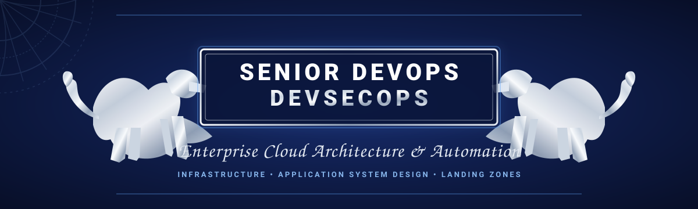
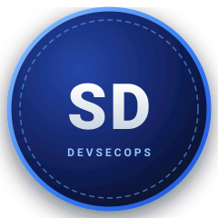
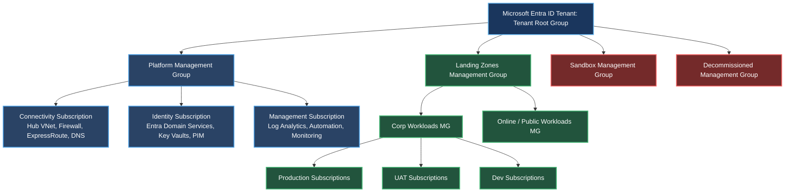
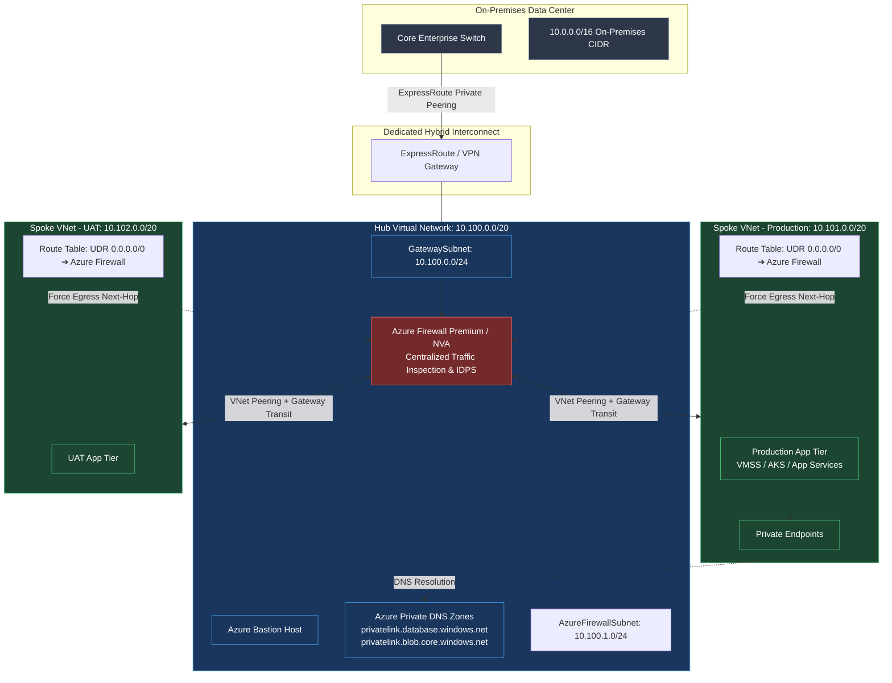
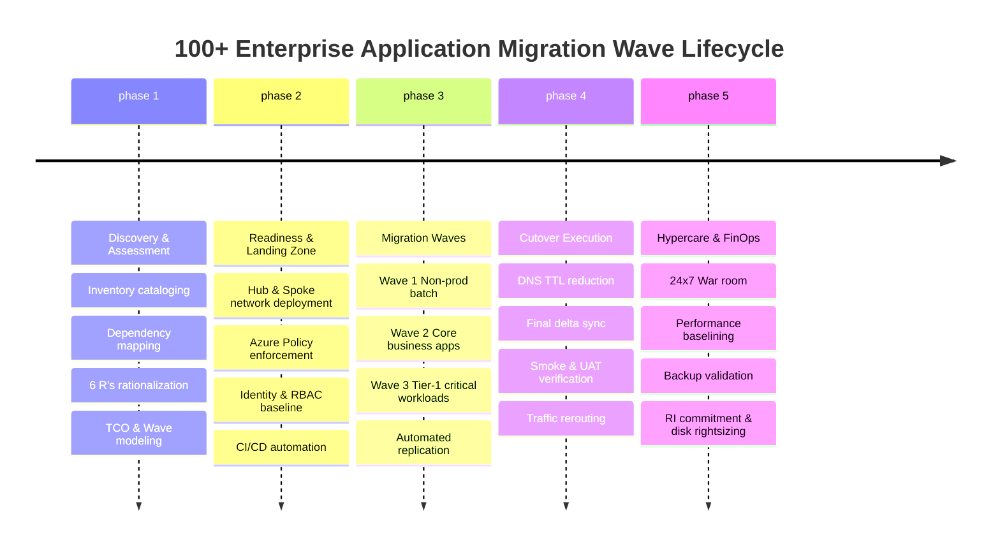
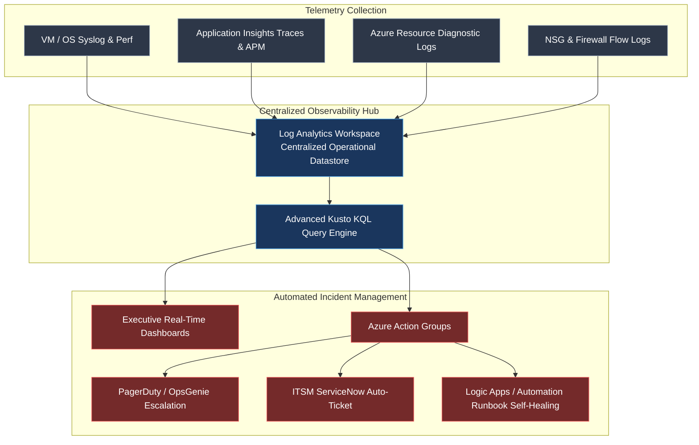

<div align="center">

<!-- Senior DevOps & DevSecOps Enterprise Header Banner -->


<br/><br/>

<table align="center" border="0" style="border: none; background: transparent;">
  <tr style="border: none; background: transparent;">
    <td align="center" width="160" style="border: none;">
      
    </td>
    <td align="left" style="border: none; padding-left: 20px;">
      <h1 style="margin: 0; font-size: 30px;">Kunj Bihari</h1>
      <h3 style="margin: 4px 0 8px 0; color: #2563EB;">Senior DevOps • DevSecOps • Enterprise Cloud Architect</h3>
      <p style="margin: 0; font-size: 14px; color: #4B5563;">
        <b>Infra &amp; Application System Design</b> • <i>Landing Zones, Zero-Trust DevSecOps, 100+ Workload Migrations &amp; FinOps</i>
      </p>
    </td>
  </tr>
</table>

---

### Infrastructure & Application Modernization • Cloud Landing Zones • Enterprise Governance • FinOps • Zero-Trust Security

[](https://azure.microsoft.com/)
[](https://www.terraform.io/)
[](https://azure.microsoft.com/en-us/products/devops/)
[](https://kubernetes.io/)
[](#-finops--cost-governance-framework)
[](#-4-tier-defense-in-depth-security-model)

---

### *"Architecting resilient, secure, self-healing, and financially optimized enterprise platforms that transform legacy footprints into cloud-native engines."*

[Executive Profile](#-executive-profile--leadership-philosophy) • [100+ App Migration Framework](#-enterprise-case-study-100-application-migration) • [Landing Zone Architecture](#-enterprise-landing-zone--governance-framework) • [Hub & Spoke Network](#-hub--spoke-networking--perimeter-security) • [Terraform IaC](#-terraform-landing-zone-automation--best-practices) • [DevSecOps Pipelines](#-azure-devops--devsecops-ci-cd-pipelines) • [FinOps & BCDR](#-finops--cost-governance-framework) • [Delivery & Leadership](#-vendor-management-rfp-governance--delivery-leadership)

---

### 📚 Featured In-Depth Engineering Playbooks
| 📘 Runbook / Playbook | Focus Area | Direct Link |
| :--- | :--- | :---: |
| **100+ Application Migration Runbook** | 6 R's, Discovery, Wave Planning, Cutover Window & Automated Rollback | [Read Runbook](./MIGRATION_CUTOVER_RUNBOOK.md) |
| **Enterprise Landing Zone & CAF Guide** | Tenant Hierarchy, IPAM CIDR, Hub-and-Spoke, Policy-as-Code & Drift Detection | [Read Architecture Guide](./ENTERPRISE_LANDING_ZONE_GUIDE.md) |
| **Vendor Management & RFP Governance** | SOW Structuring, RFP Evaluation Matrix, RACI, KT Transitions & Senior Interview Rubric | [Read Delivery Framework](./VENDOR_MANAGEMENT_AND_RFP_FRAMEWORK.md) |

---

</div>

## 📊 Executive Snapshot & Impact Metrics

```
┌───────────────────────────────────────┬───────────────────────────────────────┐
│ Enterprise Workloads Migrated         │ 100+ Apps (Dev, UAT, Production)      │
│ Infrastructure Provisioning Velocity  │ 85% Reduction via Terraform Modules   │
│ Target Availability & SLA Achieved    │ 99.99% Multi-Region High Availability │
│ Average Cloud Run-Rate FinOps Savings │ 32% - 45% Annual OpEx Optimization    │
│ Security & Compliance Baseline        │ CIS Benchmark 100% Policy Enforcement │
│ Production Release Frequency          │ Bi-weekly Manual ➔ Multiple Daily Auto│
└───────────────────────────────────────┴───────────────────────────────────────┘
```

---

## 🎯 Executive Profile & Leadership Philosophy

As a hands-on **Enterprise Cloud Architect and Technical Delivery Lead**, I operate at the strategic convergence of **Business Objectives, Software Systems Engineering, and Mission-Critical Cloud Infrastructure**. 

- **Enterprise Systems Thinking**: Translating complex enterprise requirements into scalable, robust, secure, portable, governed, and cost-efficient cloud architectures.
- **Full Lifecycle Mastery**: Driving end-to-end cloud adoption from initial discovery, TCO/ROI analysis, RFP/RFI technical responses, and Landing Zone automation, to cutover execution, hypercare, and SRE operations.
- **People & Vendor Stewardship**: Mentoring engineering teams, chairing architectural review boards (ARB), leading senior technical interview panels, managing tier-1 vendor SOWs, and establishing standard operating procedures (SOPs) with unambiguous RACI matrices.

---

## 🏗 Enterprise Landing Zone & Governance Framework

Built adhering to the **Microsoft Cloud Adoption Framework (CAF)** covering the complete lifecycle: **Strategy ➔ Plan ➔ Ready ➔ Adopt ➔ Govern ➔ Secure ➔ Manage**.

### 1. Tenant & Management Group Hierarchy
A multi-tier Management Group (MG) architecture isolating platform responsibilities from workload landing zones while enforcing deterministic policy inheritance.



### 2. Governance, RBAC & Policy Guardrails
- **Management Group Hierarchy Isolation**: Dedicated Root, Platform (Connectivity, Identity, Management), Landing Zones (Corporate, Online), Sandbox, and Decommissioned scopes.
- **Policy as Code (PaC)**: Custom Azure Policy Initiatives assigned at root and management group levels (e.g., CIS Azure Foundations Benchmark, ISO 27001, PCI-DSS):
  - *Automated Enforcement*: `Deny` unencrypted storage accounts, public blob access, unapproved VM SKUs, and internet-facing direct RDP/SSH (Port 22/3389).
  - *Self-Remediation*: `DeployIfNotExists` for Log Analytics diagnostic settings, Microsoft Defender for Cloud agents, and Network Watcher.
  - *Policy Exemptions Governance*: Formal time-bound exemption requests backed by security sign-off, documented ticket references, and compensating controls.
- **Enterprise RBAC & Identity Boundaries**:
  - Zero permanent standing access using **Microsoft Entra ID Privileged Identity Management (PIM)** with multi-factor authentication (MFA) and ticket justification.
  - Granular custom role definitions separating Platform Engineers, Security Auditors, and Application Teams.
  - Automated Subscription Onboarding & Offboarding workflows via Terraform and GitHub Actions.

---

## 🌐 Hub & Spoke Networking & Perimeter Security

A secure, centralized enterprise transit network eliminating public internet exposure for internal workloads and enforcing strict East-West and North-South traffic inspection.



### Networking Core Competencies:
- **IP Address Management (IPAM)**: Rigorous CIDR planning avoiding overlapping address spaces across 100+ on-premises subnets, branch offices, and multi-region Azure subscriptions.
- **Controlled Egress & Centralized Inspection**:
  - Spoke User-Defined Routes (UDR) routing `0.0.0.0/0` to Azure Firewall private IP.
  - TLS inspection, Threat Intelligence filtering, and Layer 7 Application Rules for outbound package registries and approved APIs.
- **Private Link Architecture**: Zero public IP exposure for Azure PaaS (SQL Database, Blob Storage, Key Vault); private endpoints connected to centralized Azure Private DNS Zones with cross-subscription VNet linking.
- **High-Availability Hybrid Connectivity**: Active-Active ExpressRoute circuits with automated VPN Gateway failover and BGP route weighting.

---

## 🔒 4-Tier Defense-in-Depth Security Model

```
┌──────────────────────────────────────────────────────────────────────────────────┐
│ 1. IDENTITY TIER                                                                 │
│ • Entra ID PIM (Just-In-Time role elevation with approval workflows)             │
│ • Adaptive Conditional Access (Compliant devices, IP whitelisting, MFA)          │
│ • Managed Identities (Eliminating hardcoded credentials across compute workloads)│
├──────────────────────────────────────────────────────────────────────────────────┤
│ 2. NETWORKING TIER                                                               │
│ • Azure Firewall Premium with IDPS & URL Category Filtering                      │
│ • Microsegmentation with Application Security Groups (ASG) & NSG Flow Logs       │
│ • Azure Front Door / Application Gateway WAF (OWASP Top 10 mitigation)           │
├──────────────────────────────────────────────────────────────────────────────────┤
│ 3. GOVERNANCE & CLOUD POSTURE TIER                                               │
│ • Microsoft Defender for Cloud (CSPM + CWPP Workload Protection)                 │
│ • Automated Azure Policy auditing with automated remediation pipelines           │
│ • Centralized Azure Key Vault with HSM protection & Customer Managed Keys (CMEK) │
├──────────────────────────────────────────────────────────────────────────────────┤
│ 4. COMPUTE & APPLICATION TIER                                                    │
│ • Hardened Golden Images (CIS Level 2) baked via HashiCorp Packer                │
│ • Container image vulnerability scanning (Trivy / Defender Vulnerability Mgmt)   │
│ • Runtime security, disk encryption with CMEK, custom data bootstrap hardening   │
└──────────────────────────────────────────────────────────────────────────────────┘
```

---

## 🚀 Enterprise Case Study: 100+ Application Migration

Migrated **100+ heterogeneous workloads** (legacy 3-tier .NET/Java apps, microservices, databases, middleware) from on-premises data centers to Azure across **Dev, UAT, and Production** environments.



### The 6 R's Application Rationalization Framework
Every single workload of the 100+ catalog was assessed and placed into a migration stream:
1. **Rehost (Lift & Shift)**: Azure Migrate / Azure Site Recovery for legacy monoliths with minimal architecture changes.
2. **Replatform (Lift & Reshape)**: App Service / Azure SQL Managed Instance migrations to eliminate OS patching overhead.
3. **Refactor / Re-architect**: Microservices containerization migrating to Azure Kubernetes Service (AKS).
4. **Repurchase**: Transitioning legacy mail and CRM to SaaS (M365, Dynamics/Salesforce).
5. **Retain**: Identifying legacy systems slated for decommissioning within 12 months.
6. **Retire**: Eliminating zombie servers, saving immediate infrastructure licensing and compute costs.

### Cutover Execution Matrix & Verification Checklists

<details>
<summary><b>📋 Click to expand: Pre-Migration, Cutover, and Post-Migration Checklists</b></summary>

#### Pre-Migration Checklist
- [x] Network connectivity verified: VNet peering, ExpressRoute bandwidth, UDRs, and Private DNS resolution tested.
- [x] Target Landing Zone subscriptions provisioned with baseline Azure Policies applied.
- [x] Initial full data synchronization completed via Azure Site Recovery / Database Migration Service.
- [x] Security clearance: Firewall rules whitelisted, NSGs configured, Defender agents installed.
- [x] Rollback plan documented, peer-reviewed, and signed off by application owners.
- [x] DNS TTL lowered to 300 seconds (5 minutes) 72 hours prior to cutover.
- [x] Maintenance window approved by CAB (Change Advisory Board) with stakeholder notification dispatched.

#### During Cutover (Cutover Window Playbook)
- [x] T-Minus 2h: Pre-cutover bridge opened (Architects, Leads, DBAs, App Owners, Network, InfoSec).
- [x] T-Minus 1h: Stop write operations on source database; place source application into read-only maintenance mode.
- [x] T-0: Trigger final delta data synchronization; verify data integrity and checksum comparison.
- [x] T+30m: Promote target database replica to primary read-write; update connection strings in Azure Key Vault.
- [x] T+45m: Start target Azure compute workloads (VMSS / App Services / AKS pods); verify application initialization logs.
- [x] T+60m: Internal smoke testing: health endpoints, authentication flows, backend database connectivity.
- [x] T+75m: Cutover DNS records / Azure Front Door backend pools to point to Azure workloads.
- [x] T+90m: End-to-end UAT sanity testing signed off by business stakeholders.
- [x] T+120m: Maintenance window closed; formal cutover success notification dispatched.

#### Post-Migration & Hypercare Checklist
- [x] 14-day Hypercare 24/7 on-call rotation initiated with priority escalation bridge.
- [x] Backup schedules validated: Azure Backup policies (LRS/GRS), instantaneous snapshot verification, test restore.
- [x] Observability baseline: Log Analytics ingestion, Application Insights tracing, alert action groups enabled.
- [x] FinOps post-migration audit: Decommission on-prem source workloads, unattach staging disks, apply 1-3 yr RIs.
- [x] Documentation handover: As-Built architecture documentation, SOPs, and runbooks transitioned to BAU operations.

</details>

---

## ⚙️ Terraform Landing Zone Automation & Best Practices

All infrastructure across Management Groups, Subscriptions, Hub-and-Spoke Networks, and Workloads is codified using **Terraform (Enterprise IaC Standards)**.

```
terraform-landing-zones/
├── modules/
│   ├── networking/hub-vnet/       # Azure Firewall, Bastion, ER Gateway
│   ├── networking/spoke-vnet/     # Peering, Subnets, UDRs, NSGs
│   ├── governance/policy-def/     # Custom Policy Definitions & Initiatives
│   ├── governance/rbac-role/      # Custom Role Definitions & PIM assignments
│   ├── compute/vmss-hardened/     # Packer CIS image, cloud-init scripts
│   └── security/private-endpoint/ # PaaS Private Link & DNS registration
├── environments/
│   ├── platform-hub/              # Hub connectivity state
│   ├── corp-prod/                 # Production workloads state
│   └── corp-uat/                  # UAT workloads state
└── .github/workflows/             # Automated validation & deployment pipelines
```

### Enterprise IaC Rigor & Security Controls
1. **Remote State Architecture**:
   - Azure Blob Storage backend with Storage Account firewall locked to specific runner IPs/Private Endpoints.
   - Blob leasing for state locking preventing concurrent execution collisions.
   - State file encryption at rest using Customer-Managed Keys (CMK) and in transit via TLS 1.3.
   - Strict least-privilege RBAC: Storage Blob Data Contributor granted exclusively to CI/CD Service Principals; zero read/write access for human users.
2. **Shift-Left Automated Quality Gates**:
   - `terraform fmt -check` & `tflint`: Automated linting and syntax verification.
   - `trufflehog` / `gitguardian`: Secret scanning in pre-commit hooks and pipeline stages.
   - `checkov` & `tfsec`: Policy-as-Code scanning against 100+ CIS and security benchmarks.
   - `infracost`: Pull request automated cost diff analysis preventing budget overruns.
3. **Continuous Drift Detection**:
   - Scheduled daily automated pipeline executing `terraform plan -detailed-exitcode`.
   - Automated Slack / Teams alerts triggered on drift detection with automatic Jira issue creation for triage.

<details>
<summary><b>💻 Click to view: Terraform Enterprise Module Code Pattern</b></summary>

```hcl
# Enterprise Hub Virtual Network & Firewall Module Definition
terraform {
  required_version = ">= 1.6.0"
  required_providers {
    azurerm = {
      source  = "hashicorp/azurerm"
      version = "~> 3.90.0"
    }
  }
  backend "azurerm" {
    resource_group_name  = "rg-terraform-state-mgmt"
    storage_account_name = "sttfstatelzprod001"
    container_name       = "tfstate-hub-networking"
    key                  = "hub.networking.terraform.tfstate"
    use_azuread_auth     = true # Zero access keys; Managed Identity authentication
  }
}

module "enterprise_hub_network" {
  source              = "git::https://dev.azure.com/enterprise/IaC-Modules/_git/terraform-azurerm-hub-network?ref=v2.4.1"
  resource_group_name = "rg-enterprise-hub-connectivity-prod"
  location            = "eastus2"
  hub_address_space   = ["10.100.0.0/20"]

  enable_azure_firewall           = true
  firewall_sku_tier               = "Premium"
  firewall_threat_intel_mode      = "Deny"
  firewall_intrusion_detection    = "AlertAndDeny"
  
  private_dns_zones = [
    "privatelink.database.windows.net",
    "privatelink.blob.core.windows.net",
    "privatelink.vaultcore.azure.net"
  ]

  tags = {
    Environment        = "Production"
    CostCenter         = "IT-Cloud-Infra"
    ManagedBy          = "Terraform"
    ComplianceStandard = "CIS-Benchmark-1.4"
  }
}
```

</details>

---

## 🔄 Azure DevOps & DevSecOps CI/CD Pipelines

A fully automated, multi-stage DevSecOps pipeline standard enforcing strict quality gates, security scanning, approval gates, and zero-downtime deployments.


### Branching Strategy & DevSecOps Standards:
- **Trunk-Based Development**: Short-lived feature branches (`feat/app-name-ticket`) merged directly into `main`.
- **Branch Protection Policies**:
  - Direct pushes and branch deletion prohibited on `main`.
  - Mandatory minimum of **2 senior peer reviews**.
  - `CODEOWNERS` signoff required for critical modules (Networking, Identity, Security policies).
  - All automated checks (Unit tests, SAST, Checkov, Infracost) must pass green before merge.
- **Middleware & Custom Data Scripts**:
  - Dynamic VM bootstrapping using standardized `cloud-init` / PowerShell Custom Data scripts to configure runtime runtimes, monitoring daemons, and hardening baselines during scale-out events.

<details>
<summary><b>📄 Click to view: Enterprise Multi-Stage Azure Pipeline YAML Template</b></summary>

```yaml
# azure-pipelines-devsecops.yml
trigger:
  branches:
    include:
      - main
pr:
  branches:
    include:
      - main

pool:
  vmImage: 'ubuntu-latest'

stages:
- stage: SecurityAndLinting
  displayName: '1. Shift-Left Security & Validation'
  jobs:
  - job: SecurityValidation
    steps:
    - script: |
        echo "Running TruffleHog Secret Scanning..."
        docker run --rm -v $(System.DefaultWorkingDirectory):/pwd trufflesecurity/trufflehog:latest filesystem /pwd --fail
      displayName: 'Secret Scan (TruffleHog)'

    - script: |
        echo "Running Checkov Policy-as-Code Static Security Scan..."
        pip install checkov
        checkov -d ./terraform --framework terraform --output junitxml --output-file-path $(Common.TestResultsDirectory)/checkov-report.xml
      displayName: 'IaC Security Scan (Checkov)'

    - task: PublishTestResults@2
      inputs:
        testResultsFormat: 'JUnit'
        testResultsFiles: '$(Common.TestResultsDirectory)/checkov-report.xml'
      condition: always()

- stage: PlanAndCost
  displayName: '2. Speculative Execution & Cost Estimation'
  dependsOn: SecurityAndLinting
  jobs:
  - job: TerraformPlan
    steps:
    - script: |
        terraform init
        terraform plan -out=tfplan.binary
      displayName: 'Terraform Plan'
    - script: |
        infracost breakdown --path tfplan.binary --format json --out-file infracost-report.json
      displayName: 'Infracost Financial Analysis'

- stage: DeployProd
  displayName: '3. Production Apply & Zero-Downtime Rollback'
  dependsOn: PlanAndCost
  condition: and(succeeded(), eq(variables['Build.SourceBranch'], 'refs/heads/main'))
  jobs:
  - deployment: DeployProduction
    environment: 'Enterprise-LandingZone-Production' # Enforces Manual Approval & Lead Signoff
    strategy:
      runOnce:
        deploy:
          steps:
          - script: |
              terraform apply -auto-approve tfplan.binary
            displayName: 'Execute Terraform Apply'
          - script: |
              # Verification Smoke Check
              HTTP_STATUS=$(curl -s -o /dev/null -w "%{http_code}" https://api.enterprise.internal/healthz)
              if [ "$HTTP_STATUS" -ne 200 ]; then
                echo "Critical: Post-deployment health verification failed! Triggering automated rollback..."
                terraform apply -auto-approve -var-file="rollback.tfvars"
                exit 1
              fi
            displayName: 'Post-Deploy Verification & Automated Rollback'
```

</details>

---

## 💰 FinOps & Cost Governance Framework

Implemented enterprise FinOps practices combining **Informed Cloud Financial Decision-Making, Waste Elimination, and Architectural Rightsizing**, delivering **32% - 45% annual OpEx savings**.

```
┌──────────────────────────────────────────────────────────────────────────────────┐
│                             FINOPS OPERATING ENGINE                              │
├─────────────────────┬──────────────────────────────┬─────────────────────────────┤
│ 1. WASTE REDUCTION  │ 2. RESOURCE RIGHTSIZING      │ 3. COMMITMENT SAVINGS       │
│ • Zombie Unattached │ • Oversized compute SKU      │ • 1-Year & 3-Year Azure     │
│   Disks Cleanup     │   downsizing via metrics     │   Reserved Instances (RIs)  │
│ • Unused Public IPs │ • Log Analytics ingestion    │ • Azure Savings Plans for   │
│   reclamation       │   filtering & table tiering  │   dynamic compute workloads │
│ • Orphaned Snapshots│ • Automated VM start/stop    │ • Storage lifecycle tiers   │
│   lifecycle purging │   schedules for non-prod     │   (Hot ➔ Cool ➔ Archive)    │
└─────────────────────┴──────────────────────────────┴─────────────────────────────┘
```

### Core Cost Optimization Tactics:
1. **Automated Zombie Asset Detection**:
   - Azure Resource Graph (ARG) queries identifying unattached managed disks, disassociated Public IP addresses, and empty App Service Plans, routing alerts for automated cleanup.
2. **Log Analytics Ingestion & Telemetry Tuning**:
   - Filtering verbose debug events at the ingestion tier. Setting table-level retention (e.g., security tables 365 days; diagnostic tables 30 days) cutting ingestion costs by up to 50%.
3. **Automated Non-Production Scheduling**:
   - Logic Apps and Azure Automation Runbooks automatically deallocating Dev/UAT environments outside core business hours (saving 65% on non-prod compute runtime).
4. **Commitment Discounts Strategy**:
   - Continuous analysis of compute baseline utilization; purchasing 1-year and 3-year Azure Reserved Instances (RIs) for steady-state workloads and Azure Savings Plans for variable workloads.

<details>
<summary><b>🔍 Click to view: Azure Resource Graph Query for Unattached Disks & Waste</b></summary>

```kusto
// FinOps Discovery: Identify All Unattached Managed Disks Across Subscriptions
resources
| where type == "microsoft.compute/disks"
| where properties.diskState == "Unattached"
| project 
    subscriptionId, 
    resourceGroup, 
    diskName = name, 
    diskSizeGB = properties.diskSizeGB, 
    storageTier = sku.tier, 
    monthlyEstimatedCost = properties.diskSizeGB * 0.05
| order by diskSizeGB desc
```

</details>

---

## 🛡️ Business Continuity, Disaster Recovery (BCDR) & High Availability

Architecting mission-critical platforms with strict **RTO (Recovery Time Objective)** and **RPO (Recovery Point Objective)** tolerances.

```
┌─────────────────┬──────────┬──────────┬──────────────────────────────────────────┐
│ Workload Tier   │ Target   │ Target   │ Architectural Implementation             │
│                 │ RTO      │ RPO      │                                          │
├─────────────────┼──────────┼──────────┼──────────────────────────────────────────┤
│ Tier 1: Core    │ < 15 Min │ < 1 Min  │ Multi-Region Active-Active, Front Door   │
│ Production Apps │          │          │ routing, ZRS/GRS SQL Failover Groups     │
├─────────────────┼──────────┼──────────┼──────────────────────────────────────────┤
│ Tier 2: Internal│ < 2 Hrs  │ < 15 Min │ Primary Active / Secondary Warm Standby, │
│ Enterprise Apps │          │          │ Azure Site Recovery (ASR) replication    │
├─────────────────┼──────────┼──────────┼──────────────────────────────────────────┤
│ Tier 3: Dev/UAT │ < 24 Hrs │ < 4 Hrs  │ Infrastructure-as-Code redeployment from │
│ Non-Production  │          │          │ Terraform repository + LRS daily backups │
└─────────────────┴──────────┴──────────┴──────────────────────────────────────────┘
```

- **Storage Resiliency Strategy**:
  - **LRS (Locally Redundant Storage)**: Temporary caching and disposable dev data.
  - **ZRS (Zone-Redundant Storage)**: Production disk storage resilient against single data center outages.
  - **GRS / RA-GRS (Geo-Redundant Storage)**: Critical backups and disaster recovery payloads replicating across Azure paired regions.
- **Compute Resiliency**:
  - Virtual Machine Scale Sets (VMSS) deployed across **3 Availability Zones (AZ)** with auto-healing and health probes.
  - Paired-region failover automation using **Azure Front Door** with instant health probe diversion.

---

## 📈 Monitoring, Observability & Site Reliability Engineering (SRE)

Full-stack distributed observability powered by **Azure Monitor, Log Analytics Workspaces, Application Insights, and Prometheus/Grafana**.



<details>
<summary><b>📊 Click to view: Production SRE KQL Monitoring Query</b></summary>

```kusto
// Production SRE Alert: Detect Error Rate Spike (HTTP 5xx) Exceeding 2% Error Budget
AppRequests
| where TimeGenerated > ago(15m)
| summarize 
    TotalRequests = count(),
    FailedRequests = countif(Success == false or toint(ResultCode) >= 500)
    by AppRoleName, bin(TimeGenerated, 5m)
| extend ErrorRatePercentage = (todouble(FailedRequests) / todouble(TotalRequests)) * 100
| where ErrorRatePercentage > 2.0 and TotalRequests > 100
| project TimeGenerated, AppRoleName, TotalRequests, FailedRequests, ErrorRatePercentage
```

</details>

---

## 🤝 Vendor Management, RFP Governance & Delivery Leadership

Enterprise architecture is as much about **People, Contracts, and Strategic Partnerships** as it is about infrastructure.

### 1. RFP, RFI & Vendor Evaluation Matrix
- Authoring high-impact **RFP (Request for Proposal)** and **RFI (Request for Information)** documents detailing cloud migration scope, SLA mandates, security standards, and acceptance criteria.
- Developing objective **Technical & Commercial Evaluation Scoring Matrices**:
  - *Architecture Capabilities (35%)*: Cloud-native maturity, security compliance, IaC automation prowess.
  - *Experience & Credentials (25%)*: Proven delivery track record on similar scale 100+ app migrations.
  - *Commercials & Pricing Model (25%)*: Milestones, blended hourly rate, T&M vs. Fixed Price risk profile.
  - *Team Composition & Upskilling (15%)*: Resource capability, certifications, and KT transition model.

### 2. SOW (Statement of Work) & Commercial Structuring
- Establishing ironclad SOWs defining:
  - **Scope & Out-of-Scope Boundaries**: Preventing insidious scope creep.
  - **Milestone-Based Deliverable Signoffs**: Linking commercial disbursements directly to verifiable technical criteria (e.g., successful UAT cutover, 100% test coverage, Zero high-severity vulnerabilities).
  - **Multi-Tier Escalation Matrix**: Defined SLA escalation pathways from Engineering Lead to VP/CIO level for blocker resolution.

### 3. Transition, Knowledge Transfer (KT) & Enterprise RACI Matrix

```
┌──────────────────────────────────────┬──────────┬──────────┬──────────┬──────────┐
│ Enterprise Transition Phase          │ Enterprise│ Platform │ Security │ Vendor / │
│                                      │ Architect│ DevSecOps│ Infosec  │ SysInt   │
├──────────────────────────────────────┼──────────┼──────────┼──────────┼──────────┤
│ Cloud Strategy & Landing Zone Design │    A     │    R     │    C     │    C     │
│ Terraform Module Creation & CI/CD    │    A     │    R     │    C     │    R     │
│ Security Baseline & Policy Guardrails│    C     │    R     │    A     │    I     │
│ Application Migration Waves Cutover  │    A     │    R     │    C     │    R     │
│ Hypercare & Post-Migration Baseline  │    A     │    R     │    C     │    R     │
│ BAU Handover, SOP Handover & Ops KT  │    A     │    R     │    I     │    R     │
└──────────────────────────────────────┴──────────┴──────────┴──────────┴──────────┘
Legend: A = Accountable (Final Signoff) | R = Responsible (Execution) | C = Consulted | I = Informed
```

### 4. Team Upskilling & Technical Interview Panels
- **Senior Technical Interviewer**: Designed enterprise technical assessment rubrics for Senior DevOps, Cloud Architect, and DevSecOps positions, evaluating hands-on coding, live system design, and security mindset.
- **Engineering Academy & Mentorship**: Conducted structured internal Knowledge Transfer (KT) sessions, brown-bag architectural workshops, and hands-on Terraform/Kubernetes labs to elevate junior and mid-level engineers into high-performing cloud specialists.

---

## 🛠️ Complete Technical Arsenal

<div align="center">

| Domain | Technologies & Platforms |
| :--- | :--- |
| **Cloud Platforms** | **Microsoft Azure** (Landing Zones, CAF, AKS, App Services, Functions, SQL MI, CosmosDB), **AWS**, Hybrid Data Centers |
| **Infrastructure as Code** | **Terraform** (Enterprise Modules, Terragrunt, State Locking), **Bicep**, **ARM Templates**, **HashiCorp Packer** |
| **DevSecOps & CI/CD** | **Azure DevOps Pipelines** (YAML Templates, Environments), **GitHub Actions**, **ArgoCD**, **Helm** |
| **Security & Governance** | **Microsoft Entra ID (PIM, Conditional Access)**, **Azure Policy**, **Defender for Cloud**, **TruffleHog**, **Checkov**, **Trivy**, **SonarQube** |
| **Networking & Transit** | **Hub & Spoke**, **Azure Firewall Premium**, **ExpressRoute**, **VPN Gateway**, **Private Link**, **Azure Front Door**, **UDR Routing** |
| **FinOps & Cost Management** | **Infracost**, **Azure Cost Management**, **Azure Resource Graph**, Reserved Instances (RIs), Savings Plans |
| **Observability & SRE** | **Azure Monitor**, **Log Analytics (KQL)**, **Application Insights**, **Prometheus**, **Grafana**, **PagerDuty** |
| **Scripting & Automation** | **Bash**, **PowerShell Core**, **Python**, **Kusto (KQL)**, **HCL** |
| **Frameworks & Delivery** | **Cloud Adoption Framework (CAF)**, **Well-Architected Framework (WAF)**, **ITIL**, **Agile/Scrum**, **RFP/SOW Management** |

</div>

---

## 📬 Connect & Collaborate

Whether you are looking to drive a **large-scale enterprise cloud transformation**, modernize **complex multi-tier application architectures**, automate **enterprise-wide landing zones**, or optimize **multi-million dollar cloud expenditures**, let's connect!

<div align="center">

[](https://linkedin.com)
[](mailto:kunjbihari1989singh@gmail.com)
[](#)

</div>
