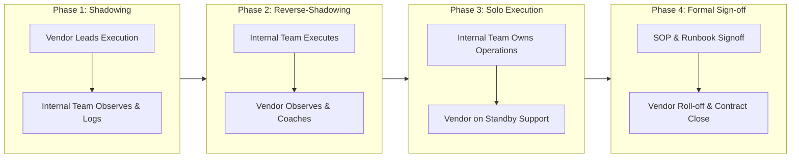

# 🤝 Enterprise Vendor Governance, RFP & Technical Delivery Framework

> **Role Focus**: Enterprise Technical Lead, Cloud Solution Architect & Delivery Practice Lead  
> **Target Audience**: C-Suite Stakeholders, Vendor Partners, Systems Integrators, Hiring Panels  
> **Key Disciplines**: Vendor SOWs, RFP/RFI Scoring, Multi-Tier Escalations, Team Upskilling, Senior Interview Frameworks  

---

## 📑 Table of Contents
1. [Statement of Work (SOW) Commercial & Delivery Architecture](#1-statement-of-work-sow-commercial--delivery-architecture)
2. [RFP & RFI Technical Evaluation Scoring Matrix](#2-rfp--rfi-technical-evaluation-scoring-matrix)
3. [Vendor Environment Access & Least Privilege Security](#3-vendor-environment-access--least-privilege-security)
4. [Escalation Matrix & Governance Cadence](#4-escalation-matrix--governance-cadence)
5. [Transition & Knowledge Transfer (KT) Playbook](#5-transition--knowledge-transfer-kt-playbook)
6. [Senior-Level DevOps & DevSecOps Technical Interview Rubric](#6-senior-level-devops--devsecops-technical-interview-rubric)

---

## 1. Statement of Work (SOW) Commercial & Delivery Architecture

When engaging tier-1 system integrators and specialized cloud consultancies, contracts must eliminate ambiguity by strictly binding financial disbursements to verifiable technical deliverables:

```
┌─────────────────────────────────────────────────────────────────────────────────────────┐
│                           ENTERPRISE SOW GOVERNANCE PILLARS                             │
├─────────────────────┬─────────────────────────────────┬─────────────────────────────────┤
│ Scope & Boundaries  │ Clear delineation of In-Scope vs. Explicitly Out-of-Scope items.│
├─────────────────────┼─────────────────────────────────┼─────────────────────────────────┤
│ Acceptance Criteria │ Deterministic, testable gates (e.g., zero P1/P2 defects,        │
│                     │ 100% automated IaC deployment, passing CIS benchmark scans).     │
├─────────────────────┼─────────────────────────────────┼─────────────────────────────────┤
│ Sprint Cadence      │ Two-week sprint iterations aligned with Agile Scrum ceremonies. │
├─────────────────────┼─────────────────────────────────┼─────────────────────────────────┤
│ Risk & Dependency   │ Explicit client vs. vendor dependency register with clear risk  │
│ Register            │ ownership matrices.                                             │
├─────────────────────┼─────────────────────────────────┼─────────────────────────────────┤
│ Milestone Payments  │ 0% advance; payments released solely upon formal stakeholder   │
│                     │ sign-off of milestone deliverables.                             │
└─────────────────────┴─────────────────────────────────┴─────────────────────────────────┘
```

### Typical Enterprise Cloud Migration Milestone Structure
- **Milestone 1 (Foundational Readiness - 20%)**: Landing Zone deployed via Terraform, Hub-and-Spoke network operational, Azure Policy initiatives enforced, zero security findings.
- **Milestone 2 (Wave 1 Non-Production Cutover - 25%)**: Migration of 30+ Dev/UAT applications, automated CI/CD pipelines live, UAT sign-off.
- **Milestone 3 (Wave 2 Core Production Cutover - 35%)**: Migration of 70+ Production workloads, cutover within approved maintenance window, zero data loss.
- **Milestone 4 (Hypercare & Final Transition - 20%)**: Completion of 14-day hypercare, SOP handover, 100% staff knowledge transfer, final commercial release.

---

## 2. RFP & RFI Technical Evaluation Scoring Matrix

When procuring vendor solutions or systems integrators, proposals are evaluated across an objective 100-point scoring matrix:

| Evaluation Category | Weight | Key Assessment Criteria |
| :--- | :---: | :--- |
| **Architecture & Cloud-Native Prowess** | **35%** | Demonstrated expertise in Terraform modularity, Azure Landing Zones, zero-trust security, Kubernetes (AKS), and automated rollback pipelines. |
| **Enterprise Migration Track Record** | **25%** | Verifiable case studies of 100+ workload migrations from legacy data centers to Azure within strict RTO/RPO windows. |
| **Commercial Terms & Pricing Structure** | **20%** | Blended hourly rate, risk-sharing milestone model, commitment to fixed-cost cap on deliverables. |
| **Security, Compliance & Tooling** | **10%** | Native integration of SAST/DAST, secret scanning, CIS Benchmarks, and SOC2 / ISO 27001 compliance standards. |
| **Transition, KT & Team Upskilling Plan** | **10%** | Depth of proposed knowledge transfer sessions, quality of runbooks, and enablement of in-house engineers. |

---

## 3. Vendor Environment Access & Least Privilege Security

Vendor access is governed by strict Zero-Trust principles to protect enterprise intellectual property and production workloads:

- **Identity Federation**: No external guest credentials; vendors provisioned with corporate Entra ID accounts subject to Conditional Access (device compliance, FIDO2/MFA, location boundaries).
- **Entra ID PIM (Privileged Identity Management)**: Time-bound, just-in-time (JIT) role activation (maximum 8 hours) with mandatory justification and manager approval.
- **Dedicated Vendor Bastion / VDI**: Vendor access restricted to secure Azure Virtual Desktops (AVD) with clipboard redirection and local disk drive mapping disabled.
- **Repository Branch Policies**: Vendors work exclusively on short-lived feature branches; merges to `main` require approval from internal enterprise architects.

---

## 4. Escalation Matrix & Governance Cadence

A deterministic communication and escalation cadence resolves delivery bottlenecks proactively:

```
Level 4: Executive Sponsor (CIO / VP of Engineering)
   ▲ (Escalated after 48h of unmitigated critical blocker)
Level 3: Enterprise Lead Architect / Delivery Lead
   ▲ (Escalated after 24h of milestone delay or scope dispute)
Level 2: Scrum Master & Technical Leads (Vendor + Enterprise)
   ▲ (Escalated after 4h of build/test/access impediment)
Level 1: Working Sprint Engineers & Cloud Practitioners
```

### Weekly Governance Cadence
- **Daily 15-min Standup**: Blocker identification and sprint burn-down tracking.
- **Weekly Architecture Review (ARB)**: Formal review of technical designs, policy exemptions, and infrastructure pull requests.
- **Bi-Weekly Commercial Review**: Vendor account manager review of milestone progress, burn-rate, and scope change requests.
- **Sprint Retrospective**: Actionable feedback loop optimizing delivery throughput.

---

## 5. Transition & Knowledge Transfer (KT) Playbook

A structured 4-phase transition framework ensuring zero dependency on external vendors post-delivery:



### Knowledge Transfer Artifacts Checklist
- [x] As-Built Architecture Diagrams (Visio / Mermaid / Draw.io) with complete IPAM mappings.
- [x] Terraform Module Registry documentation with input/output variable schemas.
- [x] Standard Operating Procedures (SOPs) for routine maintenance, certificate rotations, and backup restorations.
- [x] Emergency Disaster Recovery (DR) and business continuity failover runbooks.
- [x] Recorded KT sessions with timestamped indices archived in corporate knowledge base.

---

## 6. Senior-Level DevOps & DevSecOps Technical Interview Rubric

As a lead interviewer for senior and principal cloud engineering roles, candidates are evaluated across four rigorous dimensions:

### 1. Hands-On Systems & IaC Architecture (30%)
- **Prompt**: *"Design a multi-region Terraform landing zone for an enterprise banking workload requiring zero public ingress and compliance with PCI-DSS."*
- **Key Indicators**: Discusses remote state locking, least-privilege storage access, modularity, dynamic CIDR allocation, Private Link, and automated drift detection.

### 2. DevSecOps & Zero-Trust Pipelines (25%)
- **Prompt**: *"Walk me through your branching strategy and how you enforce security gates in an Azure DevOps YAML pipeline before code hits production."*
- **Key Indicators**: Recommends trunk-based development, branch policies, secret scanning (TruffleHog), static security analysis (Checkov/tfsec), manual approval gates, and automated smoke test rollbacks.

### 3. Production Incident Troubleshooting & SRE (25%)
- **Prompt**: *"A critical production web service in an AKS cluster experiences intermittent 502/504 Bad Gateway errors after a peak traffic surge. How do you triage?"*
- **Key Indicators**: Systematically examines ingress controller logs, Network Security Groups, pod memory limits (OOMKilled), HPA scaling thresholds, KQL queries in Log Analytics, and dependency latency.

### 4. Leadership, Stakeholder & FinOps Acumen (20%)
- **Prompt**: *"How do you balance developer deployment velocity with strict InfoSec compliance and tight FinOps cloud budgets?"*
- **Key Indicators**: Advocates Policy-as-Code self-service guardrails over manual ticket approvals; shares concrete examples of rightsizing, reserved instances, and automated non-prod schedules.
